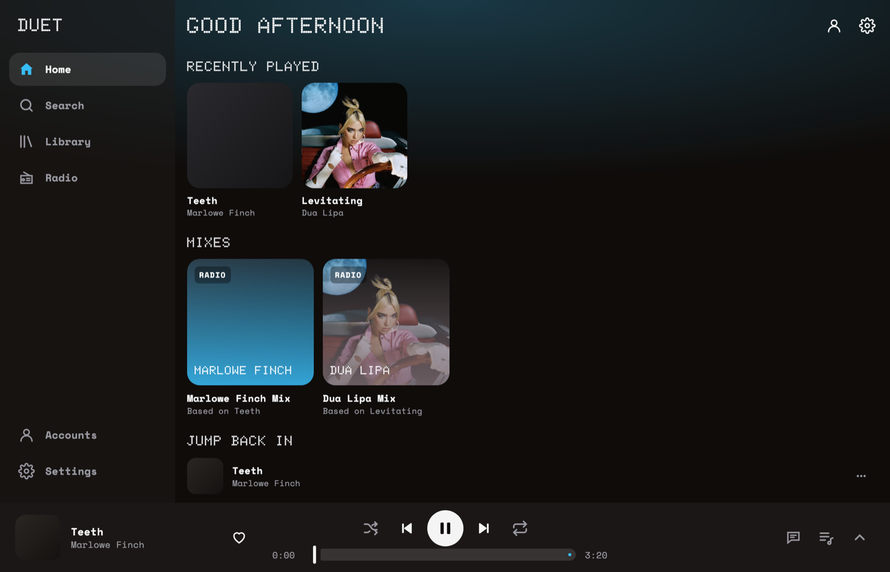
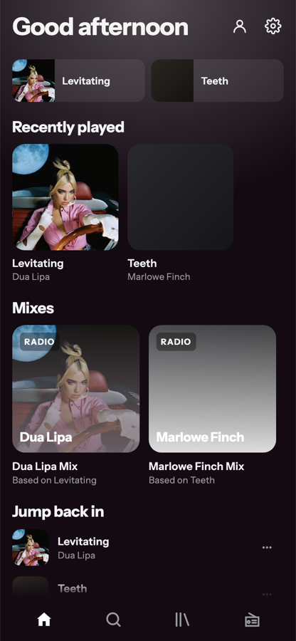
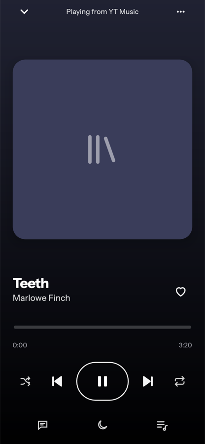
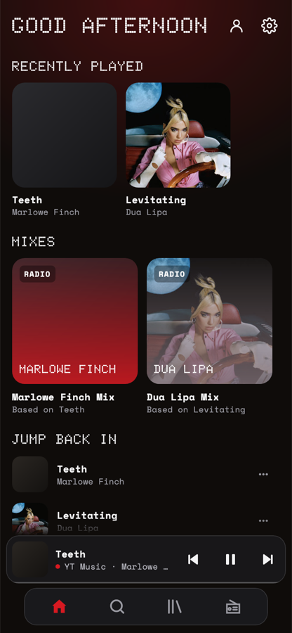
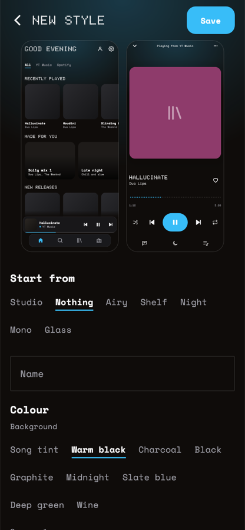
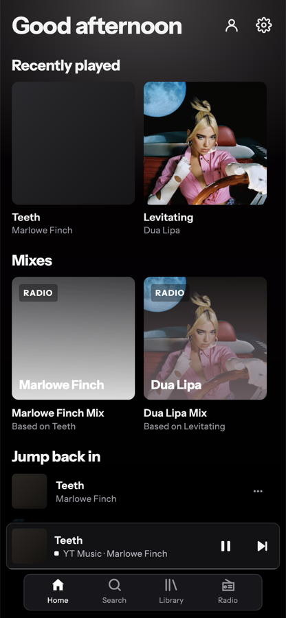

<div align="center">

# Duet

**One music app for Spotify and YouTube Music.** One search, one queue, one player.

Android · macOS (Apple Silicon and Intel) · Windows

[**Download**](../../releases/latest) · [What it does](#what-it-does) · [Make it yours](#make-it-yours) · [Build it](#build-it)



</div>

## Download

Get the newest build from the [Releases page](../../releases/latest).

| Your device | File | Notes |
|---|---|---|
| Android phone | `Duet-<version>.apk` | Allow "install from this source" when Android asks. Updates itself from inside the app. |
| Mac with Apple Silicon (M1 and newer) | `Duet-<version>-mac-arm64.dmg` | Open the DMG and drag Duet to Applications. |
| Mac with an Intel chip | `Duet-<version>-mac-x64.dmg` | Same. |
| Windows 10 / 11 | `Duet-<version>-windows.zip` | Unzip it and run `Duet.exe`. |

Duet is not signed with a paid developer certificate, so each system warns once:

- **Mac:** if the DMG says "Could not install", that is macOS's own installer rejecting an unsigned app and nothing has changed: just drag Duet to Applications yourself. Do not run it from the DMG. If macOS then refuses to open it ("damaged", "can't be opened"), run this once in Terminal, then open Duet normally: `xattr -dr com.apple.quarantine /Applications/Duet.app`. Without Terminal: try to open Duet, then go to System Settings > Privacy & Security, scroll down to the message about Duet and click Open Anyway. (Right-click > Open no longer works on macOS 15 and newer.)
- **Windows:** at the blue SmartScreen box choose "More info", then "Run anyway".

## Spotify on a computer

Open Settings, then Music services, then Spotify, and choose Sign in. Spotify's own login page opens in a window (email, Google, Facebook or Apple). No Spotify developer app and no Premium account are needed. If the sign-in window will not work, "Paste cookie instead" takes the `sp_dc` cookie copied from your normal browser.

Your Spotify library, playlists and likes work, and you can search Spotify signed out too. Songs from Spotify play through YouTube Music's copy of the song (there is no Spotify player on a computer).

## What it does

- **Spotify and YouTube Music together.** Search both at once, keep one queue, and play from either. Sign in to either or both. On a computer, Spotify songs play through YouTube Music's copy of the song.
- **Internet radio** from stations around the world, by country, with favourites.
- **Your library in one place:** liked songs, your own playlists mixing both services, albums and artists, and your Spotify and YouTube Music playlists (add, remove, reorder, rename).
- **Lyrics** that scroll with the song, a sleep timer, a play history and listening stats, and scrobbling to ListenBrainz.
- **Sound that is yours:** equalizer, bass boost, playback speed and balance. On Android also loudness, reverb, crossfade and offline downloads.
- **On Android only:** background playback with lock-screen controls, Android Auto, a home-screen widget and in-app updates.

<p align="center">
  
  
  
</p>

## Make it yours

Nothing about how Duet looks is fixed.

- **Styles.** Seven built-in looks (Studio, Nothing, Airy, Shelf, Night, Mono, Glass), each in dark and light. The style editor changes everything you can see: background and its effect, fonts, corner roundness, the size and spacing of cards, the now-playing bar, the player, the tab bar and more, with a live preview of the real screens.
- **Your own highlight colour** on top of any style, per person.
- **CSS themes.** Copy any style out as CSS, edit it by hand or hand it to an AI with the built-in prompt, and paste it back in.
- **Shared styles.** Share a style you made, try other people's. Phone styles and computer styles stay separate, because the layouts differ.

<p align="center">
  
  
</p>

## Build it

Duet is Kotlin Multiplatform with Compose Multiplatform: one shared app, a phone shell and a computer shell.

```
shared/        the app: screens, players' interface, sources (Spotify, YouTube Music, radio), styles
androidApp/    the Android shell: ExoPlayer, Android Auto, widget, in-app updates
desktopApp/    the Mac and Windows shell: a window, JavaFX audio
docs/          the spec, decisions, release steps, desktop notes
scripts/       build-mac.sh and build-windows.bat
```

- **Android:** JDK 17 and the Android SDK, then `./gradlew :androidApp:assembleDebug`. Release steps are in [docs/RELEASING.md](docs/RELEASING.md).
- **Mac:** `./scripts/build-mac.sh` (or `./scripts/build-mac.sh x64` for Intel) makes `dist/Duet-<version>-mac-<chip>.dmg`.
- **Windows:** run `scripts\build-windows.bat`. It installs Java if needed and makes `dist\Duet-<version>-windows.zip`.
- **Try it without installing:** `./gradlew -PdesktopOnly :desktopApp:run`.

More: [docs/DESKTOP.md](docs/DESKTOP.md) (the computer apps), [docs/SPEC.md](docs/SPEC.md) (the product), [docs/DECISIONS.md](docs/DECISIONS.md) (why things are the way they are).

## Licence and credits

Duet is free software under the [GNU GPL v3](LICENSE). YouTube streams come from [NewPipe Extractor](https://github.com/TeamNewPipe/NewPipeExtractor) (GPL-3.0). Parts come from [SpatialFlow](https://github.com/MythicalSHUB/SpatialFlow) (Apache-2.0), and Spotify playback follows the approach of [Myspoti](https://github.com/kota-zo/myspoti). The full list is in [docs/THIRD_PARTY.md](docs/THIRD_PARTY.md).

Duet is not made by, or endorsed by, Spotify or YouTube. YouTube Music is reached through unofficial endpoints that can change without notice.

## Legal notice and fair use

Duet is an independent hobby project. It is not made, endorsed or sponsored by Spotify, Google or YouTube, and those names belong to their owners.

**We do not condone piracy.** Please support the artists you listen to. Duet is not built for, and must not be used for, copying, sharing, reselling or distributing copyrighted music, or for getting around a paywall, licence or any other protection.

- **Duet does not provide music.** It is only a player. You sign in with your own Spotify and YouTube Music accounts and you need the rights to what you play. It contains no music and no list of pirated music.
- **Offline songs are for you.** Songs saved for offline use are for your own private listening on your own devices.
- **Unofficial access.** The Spotify and YouTube Music parts talk to those services in ways they do not officially support, which may go against their terms of service. Using Duet may get an account limited or closed. You use it at your own risk and you are responsible for following those terms and the laws where you live.
- **Radio stations** come from a public directory. Their streams belong to the stations.
- **No warranty.** Duet is free software under the GNU GPL v3 (see `LICENSE`) and comes with no warranty. The authors are not liable for what you do with it.
- **Rights holders:** if you think something in this repository infringes your rights, open an issue and it will be looked at.

This is not legal advice.

---

It was vibecoded lol.
